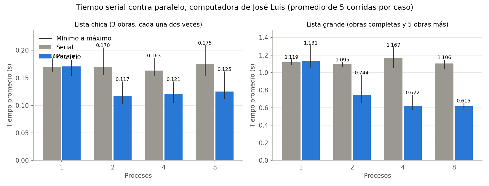
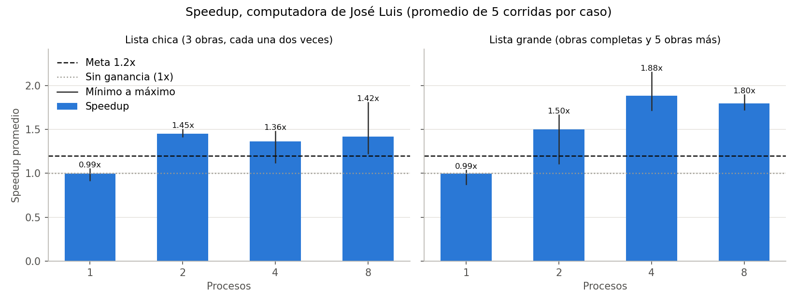

# Bolsa de Palabras con MPI
## Integrantes
* Jose Luis Santiago Heredia, 208322
* Miguel Ángel Herrera, 206111

## Objetivo
Tenemos k libros de Project Gutenberg y queremos saber cuántas veces aparece cada palabra en cada libro. El resultado es la matriz de Bolsa de Palabras: un renglón por libro y una columna por cada palabra que aparece en alguno de los libros, con 0 cuando la palabra no está en ese libro. Es la misma matriz que arma `CountVectorizer` en la libreta de la clase.

Contar palabras de libros grandes toma tiempo, así que hicimos una versión serial y una versión paralela con MPI, y comparamos sus tiempos con el speedup.

## Programa
### Entrada y salida
Los dos programas reciben un archivo de texto con una url de Project Gutenberg por renglón. La url puede ser la del texto del libro (termina en `.txt`) o la página del libro, como `https://www.gutenberg.org/ebooks/1513`, y en ese caso el programa arma la url del texto con el número del libro. El número de procesos se da al correr la versión paralela con `mpiexec -n q`.

Los libros se descargan cada vez que se corre el programa y se guardan en la carpeta `libros`. La matriz se escribe en la carpeta `resultados`: `bolsa_serial.csv` para el serial y `bolsa_mpi.csv` para MPI. El primer renglón es `libro` seguido de todas las palabras en orden alfabético, y en cada renglón siguiente va el nombre del libro (por ejemplo `pg1513`) y sus conteos.

En la carpeta hay cuatro listas de urls:
* `urls.txt`: los seis libros del escenario del enunciado (El mercader de Venecia, Romeo y Julieta y Hamlet, dos veces cada uno), con las urls oficiales.
* `urls_grande.txt`: las obras completas de Shakespeare y cinco obras más, para tener más texto.
* `urls_espejo.txt` y `urls_espejo_grande.txt`: los mismos libros desde un espejo oficial de Project Gutenberg. Los agregamos porque el día que hicimos las pruebas gutenberg.org estaba en mantenimiento y respondía error 503.

### Regla para separar palabras
El texto se pasa a minúsculas y una palabra es una secuencia de letras (de la a a la z) y dígitos que tenga 2 o más caracteres. Cualquier otro carácter separa palabras: espacios, puntuación, apóstrofos, guion bajo y caracteres que no son ASCII, como las letras con acento o las comillas curvas. Por ejemplo, en `Hamlet, HAMLET! hamlet.` la palabra `hamlet` aparece 3 veces, en `I am a man` solo cuentan `am` y `man`, y `don't` cuenta como `don`.

Es la misma regla que `CountVectorizer` usa por omisión, con una diferencia: el patrón por omisión de sklearn también acepta guion bajo y letras con acento. Como los libros están en inglés casi no hay acentos, pero Project Gutenberg marca las cursivas con guiones bajos (`_Hamlet_`), y sklearn las contaría como otra palabra. Por eso la verificación usa `CountVectorizer(lowercase=True, token_pattern=r"[a-z0-9]{2,}")`, que es exactamente nuestra regla. Se cuenta el texto completo tal como se descarga, incluyendo el encabezado y la licencia de Project Gutenberg, igual que en la libreta de la clase.

## Códigos
### Funciones comunes
Las funciones que usan los dos programas están en `bolsaComun.h`, para que el serial y el paralelo cuenten exactamente igual y la diferencia de tiempo venga solo del paralelismo:
* `urlDelTexto` y `nombreDelLibro` convierten la url de la página en la url del texto y sacan el nombre del libro.
* `contarUrls` y `leerUrls` leen el archivo de urls, igual que `contarPuntos` y `leerPuntos` en el primer proyecto.
* `descargarLibro` llama a `curl` y revisa que el archivo no haya quedado vacío. Usa la opción `-f` para que un error del servidor cuente como descarga fallida, y si algún libro falla el programa avisa cuál fue y termina sin escribir la matriz.
* `contarPalabras` recorre un pedazo del texto carácter por carácter. Mientras el carácter sea letra o dígito va armando la palabra en minúsculas, y cuando encuentra un separador suma la palabra al diccionario `map<string, int>` del libro, si tiene 2 o más caracteres.
* `inicioDeRebanada` y `finDeRebanada` calculan qué pedazo de cada libro le toca a cada proceso en la versión MPI. El serial las usa con 1 proceso, así su pedazo es el libro completo.
* `juntarVocabulario` junta las palabras de todos los libros en un solo diccionario. Como es un `map`, las palabras ya quedan en orden alfabético, que es el orden de las columnas.
* `escribirCsv` escribe la matriz. Abre el archivo en modo binario para que en Windows y en Linux salga exactamente igual.

Las pruebas de estas funciones están en `pruebas/pruebaComun.cpp`. Revisan las urls, los ejemplos de la regla de palabras, el csv y que repartir un texto en rebanadas con 1 a 16 procesos dé el mismo conteo que el texto completo.

### Serial
`bolsaSerial.cpp` lee las urls, descarga los libros, los lee a memoria y luego hace el conteo. Hace una corrida de calentamiento que no se mide y después repite 10 veces contar las palabras de todos los libros y juntar el vocabulario, y saca el promedio. Solo eso se mide: la descarga, la lectura de los archivos y la escritura del csv quedan fuera, en el serial y en el paralelo. El tiempo se mide con `clock()` como en el primer proyecto; como el serial corre en un solo hilo, equivale al tiempo real.

Para comprobar que el serial es correcto se comparó contra `CountVectorizer` con la regla de arriba en `analisis.ipynb`, que lee los mismos archivos de `libros`. El vocabulario, el orden de las columnas y todos los conteos coinciden.

### MPI: cada proceso cuenta una rebanada de cada libro
En MPI cada proceso es un programa aparte con su propia memoria, y se identifica con su número, el rank, que va de 0 a q - 1. El proceso 0 es el maestro, igual que en `mpi_hello_world.cpp` de la clase. El programa arranca con `MPI_Init`, `MPI_Comm_size` y `MPI_Comm_rank`, y termina con `MPI_Finalize`.

Solo el maestro descarga los libros. Después avisa a todos con `MPI_Bcast` si la descarga salió bien, y como los demás procesos se quedan esperando ese aviso, nadie lee un libro antes de que termine de bajarse. Si alguna descarga falló, todos terminan sin escribir nada. Luego cada proceso lee los libros del disco a su propia memoria, fuera del tiempo medido.

La primera idea fue repartir libros completos, un libro por proceso, pero tiene dos problemas: si hay menos libros que procesos, algunos procesos se quedan sin trabajo, y si un libro es mucho más grande que los demás, el proceso que lo cuenta decide el tiempo total. Por eso cada proceso cuenta la misma fracción de cada libro:
```
             libro 0                       libro 1
   +--------+--------+--------+   +----+----+----+
   |   P0   |   P1   |   P2   |   | P0 | P1 | P2 |   ...
   +--------+--------+--------+   +----+----+----+
```
La rebanada del proceso con rank r empieza en el carácter tamaño * r / q. El problema es que la división puede caer a la mitad de una palabra. La regla que usamos es que una palabra le pertenece al proceso en cuya rebanada cae su primer carácter. Entonces, si el inicio de una rebanada cae a la mitad de una palabra, se recorre hasta que la palabra termina, porque esa palabra la empezó el proceso anterior. Y cada rebanada termina justo donde empieza la siguiente. Como todos los procesos usan la misma regla, ninguna palabra se parte, se pierde ni se cuenta dos veces. Así todos cuentan casi la misma cantidad de texto, aunque haya 2 libros y 8 procesos.

Al terminar de contar, cada proceso tiene un diccionario por libro con los conteos de sus rebanadas, y hay que juntarlos en el maestro. `MPI_Reduce` no sirve directo porque solo suma arreglos de números del mismo tamaño en todos los procesos, y aquí cada proceso tiene un vocabulario distinto, de distinto tamaño y hecho de palabras. Por eso usamos comunicación punto a punto: cada proceso convierte sus diccionarios en un texto con un renglón `libro palabra cantidad` por entrada, y lo manda al maestro con dos `MPI_Send`, primero el tamaño del texto y luego el texto. El maestro hace `MPI_Recv` de cada proceso, lee los renglones y los suma a sus propios conteos. Al final junta el vocabulario y escribe el csv.

El tiempo de una repetición empieza después de un `MPI_Barrier`, para que todos arranquen juntos, y termina cuando el maestro acabó de sumar lo de todos y de juntar el vocabulario. Se mide con `MPI_Wtime`, que es tiempo de reloj de pared. Igual que en el serial, hay una corrida de calentamiento y luego se promedian 10 repeticiones.

Para calcular el speedup en la misma corrida, el maestro también corre la versión serial (las mismas funciones sobre los libros completos, igual que `bolsaSerial.cpp`) mientras los demás esperan en una barrera. Así el tiempo serial y el paralelo salen del mismo reloj, de los mismos datos y de la misma corrida. El speedup es el tiempo serial entre el tiempo paralelo. Al final el maestro compara su matriz contra la serial celda por celda, imprime si son idénticas y agrega un renglón a `resultados/tiempos_<letra>.csv` con el archivo de urls, los procesos, los libros, los dos tiempos y el speedup.

## Resultados
### Equipos
Igual que en el primer proyecto, los archivos de tiempos terminan con una letra para distinguir la computadora: J para la de José Luis y M para la de Miguel.
* José Luis: Intel Core i3 1115G4, con 2 núcleos físicos y 4 cores virtuales, Windows 10, g++ 16.1.0 de MSYS2 y MS-MPI. Se probaron 1, 2, 4 y 8 procesos.
* Miguel: AMD Ryzen AI 7 350, con 8 núcleos físicos y 16 cores virtuales, Ubuntu en WSL2 con g++ 15.2.0 y OpenMPI. Se prueban 1, 4, 8 y 16 procesos.

Los programas se compilaron sin opciones de optimización, igual que en el primer proyecto, y con los mismos comandos en las dos computadoras.

### Verificación
En todas las corridas el programa imprimió que la matriz paralela es idéntica a la serial, y `bolsa_mpi.csv` es igual byte por byte a `bolsa_serial.csv`. También se probaron los casos difíciles: 2 libros con 8 procesos (más procesos que libros), 1 solo proceso y 16 procesos sobre un texto de 10 caracteres en las pruebas, donde varios procesos se quedan con rebanadas vacías. La comparación contra `CountVectorizer` está en `analisis.ipynb`.

### Tiempos en la computadora de José Luis
Corrimos 5 veces cada combinación de lista y número de procesos con el ciclo de la sección de abajo. Las tablas tienen el promedio de las 5 corridas, y la última columna el speedup más bajo y el más alto que salieron.

Lista chica, los seis libros del enunciado (154,650 palabras y 7,358 columnas):

| Procesos | Serial (s) | Paralelo (s) | Speedup | Rango del speedup |
|---|---|---|---|---|
| 1 | 0.169 | 0.171 | 0.99 | 0.92 a 1.05 |
| 2 | 0.170 | 0.117 | 1.45 | 1.42 a 1.50 |
| 4 | 0.163 | 0.121 | 1.36 | 1.12 a 1.48 |
| 8 | 0.175 | 0.125 | 1.42 | 1.23 a 1.81 |

Lista grande, las obras completas de Shakespeare y cinco obras más (24,851 columnas):

| Procesos | Serial (s) | Paralelo (s) | Speedup | Rango del speedup |
|---|---|---|---|---|
| 1 | 1.119 | 1.131 | 0.99 | 0.88 a 1.04 |
| 2 | 1.095 | 0.744 | 1.50 | 1.11 a 1.67 |
| 4 | 1.167 | 0.622 | 1.88 | 1.72 a 2.16 |
| 8 | 1.106 | 0.615 | 1.80 | 1.73 a 1.89 |





En las gráficas la barra es el promedio y la línea negra va de la corrida más baja a la más alta. Los números de cada corrida están en `resultados/tiempos_J.csv`.

Con 1 proceso el speedup queda alrededor de 1 porque es el mismo trabajo que el serial más el costo de arrancar MPI. Con 2 procesos o más el promedio pasa de 1.2 en todos los casos. De las 30 corridas con 2 procesos o más, solo dos quedaron abajo de 1.2: una de 1.12 con la lista chica y 4 procesos, y una de 1.11 con la lista grande y 2 procesos. Con la lista chica los tiempos son de décimas de segundo, así que cualquier otro programa que use la computadora en ese momento mueve mucho el resultado. Con la lista grande hay más texto por proceso y con 4 y 8 procesos todas las corridas quedaron entre 1.72 y 2.16.

### Por qué el speedup no llega a 4 con 4 procesos
Medimos por separado cada parte de la versión paralela con la lista chica y 4 procesos (promedio por repetición):

| Parte | Quién la hace | Tiempo (s) |
|---|---|---|
| Contar su rebanada | todos, en paralelo | 0.063 a 0.067 |
| Mandar sus conteos | procesos 1, 2 y 3 | 0.005 a 0.012 |
| Recibir y sumar los conteos | solo el maestro | 0.035 |
| Juntar el vocabulario | solo el maestro | 0.019 |

Hay dos razones. La primera es que contar con 4 procesos no tarda la cuarta parte que en serial (0.143 s), sino un poco menos de la mitad, porque la computadora solo tiene 2 núcleos físicos y los 4 cores virtuales los comparten. Por eso con 8 procesos tampoco mejora mucho más. La segunda es que juntar los conteos lo hace solo el maestro, uno después de otro, y eso es casi la mitad del tiempo paralelo. Es la Ley de Amdahl de las diapositivas de introducción: la parte serial limita el speedup sin importar cuántos procesos haya. Con la lista grande la parte de contar pesa más que la de juntar (granularidad más gruesa), y por eso el speedup es más alto y más estable.

### Tiempos en la computadora de Miguel
Pendiente: se agregan cuando Miguel corra los programas con los comandos de abajo y suba `resultados/tiempos_M.csv`.

## Cómo compilar y correr
Desde la carpeta del proyecto, en la computadora de José Luis (Windows con g++ de MSYS2):
```
g++ bolsaSerial.cpp -o bolsaSerial
.\bolsaSerial.exe urls.txt J
```
El segundo argumento es la letra de la computadora y es opcional. Se puede agregar un tercero con el número de repeticiones, por ejemplo `.\bolsaSerial.exe urls.txt J 5`.

La versión MPI se compila con el SDK de MS-MPI y se corre con `mpiexec`, donde `-n` es el número de procesos:
```
g++ bolsaMPI.cpp -o bolsaMPI -I "C:\msmpi\Sdk\Include" -L "C:\msmpi\Sdk\Lib\x64" -lmsmpi
mpiexec -n 4 .\bolsaMPI.exe urls.txt J
```

En la computadora de Miguel (Ubuntu en WSL2 con OpenMPI):
```
g++ bolsaSerial.cpp -o bolsaSerial
mpic++ bolsaMPI.cpp -o bolsaMPI
./bolsaSerial urls.txt M
mpirun -n 4 ./bolsaMPI urls.txt M
```

Si gutenberg.org no responde, se pueden usar las listas `urls_espejo.txt` y `urls_espejo_grande.txt` en lugar de `urls.txt` y `urls_grande.txt`.

### Experimento completo
Para las gráficas corrimos 5 veces cada combinación de lista y número de procesos. Cada corrida agrega su renglón a `resultados/tiempos_<letra>.csv`, así que basta con repetir el mismo ciclo. En PowerShell, en la computadora de José Luis:
```
foreach ($ronda in 1..5) {
    foreach ($lista in "urls.txt", "urls_grande.txt") {
        foreach ($q in 1, 2, 4, 8) {
            mpiexec -n $q .\bolsaMPI.exe $lista J
        }
    }
}
```

En bash, en la computadora de Miguel:
```
for ronda in 1 2 3 4 5; do
    for lista in urls.txt urls_grande.txt; do
        for q in 1 4 8 16; do
            mpirun -n $q ./bolsaMPI $lista M
        done
    done
done
```
Si `mpirun` dice que no hay suficientes lugares para 16 procesos, es porque OpenMPI cuenta núcleos físicos y no cores virtuales; se arregla agregando `--oversubscribe` después de `mpirun`.

### Libreta de análisis
`analisis.ipynb` compara la matriz contra `CountVectorizer` y dibuja las gráficas de `graficas/` a partir de los archivos de tiempos. Antes de correrla hay que correr `bolsaSerial` y `bolsaMPI` con la misma lista, porque la verificación lee los libros de `libros/` y los dos csv. Necesita pandas, matplotlib y sklearn; en la computadora de José Luis están en Anaconda, y se corre desde el Anaconda Prompt en la carpeta del proyecto con:
```
jupyter nbconvert --to notebook --execute --inplace analisis.ipynb
```
También se puede abrir con `jupyter notebook` o subirla a Colab junto con las carpetas `libros` y `resultados`.

Para correr las pruebas de las funciones comunes:
```
g++ pruebas/pruebaComun.cpp -o pruebas/pruebaComun
.\pruebas\pruebaComun.exe
```
